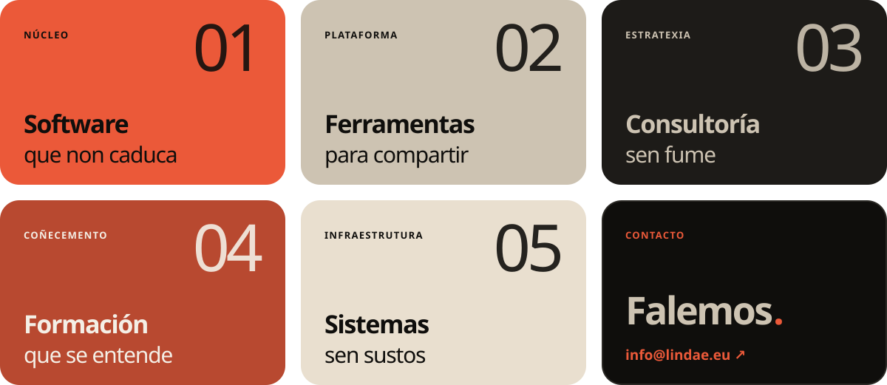

 

> Somos a cooperativa tecnolóxica da **economía social e solidaria**. Acompañamos a asociacións, fundacións, cooperativas e colectivos que coidan o que importa, e **coidamos a súa tecnoloxía** para que eles poidan seguir facéndoo.

### Que facemos

### Como acompañamos

| Antes | Durante | Despois | Sempre |
|---|---|---|---|
| **Escoitamos sen présa** | **Traballamos á vista** | **Formamos e documentamos** | **Seguimos aí** |
| Unha primeira conversa sen compromiso. | Avances frecuentes e linguaxe clara. | O coñecemento queda na casa. | Mantemento, soporte e melloras. |

### O que nunca vos faremos

**Atarvos a nós** — código libre e documentado, datos vosos en formatos abertos.

---

<b>A boa tecnoloxía non se nota.</b> ata que deixa de funcionar. Por iso a coidamos.

  <a href="https://lindae.eu">lindae.eu</a> ·
  <a href="mailto:info@lindae.eu">info@lindae.eu</a> ·
  <a href="https://www.linkedin.com/company/lindae">LinkedIn</a> ·
  <a href="https://mastodon.gal/@lindae" rel="me">Mastodon</a>
   Ames · Santiago de Compostela · Galicia

